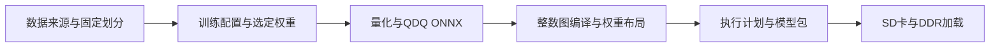
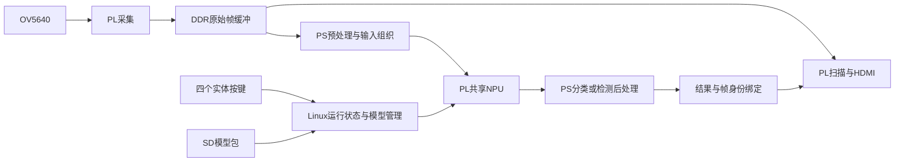

# 系统架构与流程

## 模型准备链路

三份运行配置使用两种网络结构：ResNet18六分类、YOLOX-S NEU6、YOLOX-S COCO80。COCO权重为预训练导入。板上输入为ResNet 160×160、两个YOLOX 256×256；原始训练/导出尺寸与当前部署尺寸分开说明，见 model_pipeline.md。

## 板端数据与控制链路

相机原始帧、推理输入、中间张量及模型数据使用明确的DDR地址合同。Linux驱动管理NPU寄存器与共享内存，运行时负责模型校验、任务提交、完成处理和安全切换。显示使用与结果对应的原始帧；模型选择与启停不通过整帧CPU UI绘制实现。

硬件侧在同一计算阵列上执行不同模型的图计划；模型切换是参数与执行计划切换，不是动态部分重配置，也不表示三模型同时计算。

## 设计文档导航

- [硬件与地址接口](hardware.md)
- [全部 61 份硬件 RTL 的中文作用及启用边界](hardware_modules.md)
- 模型训练来源、量化、编译与打包：model_pipeline.md
- 当前PS共享算法与可选裸机入口：baremetal.md
- Linux、SD、驱动、设备树及自启动：linux.md
- 缺失材料与验证范围：missing_artifacts.md

