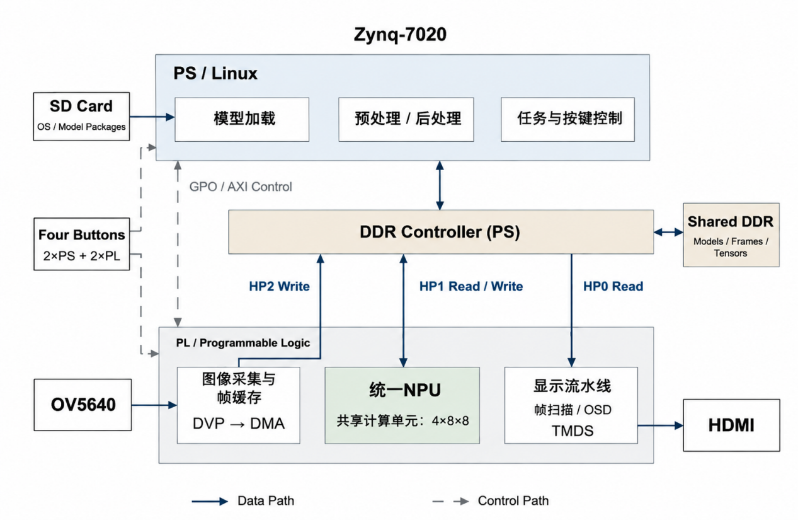
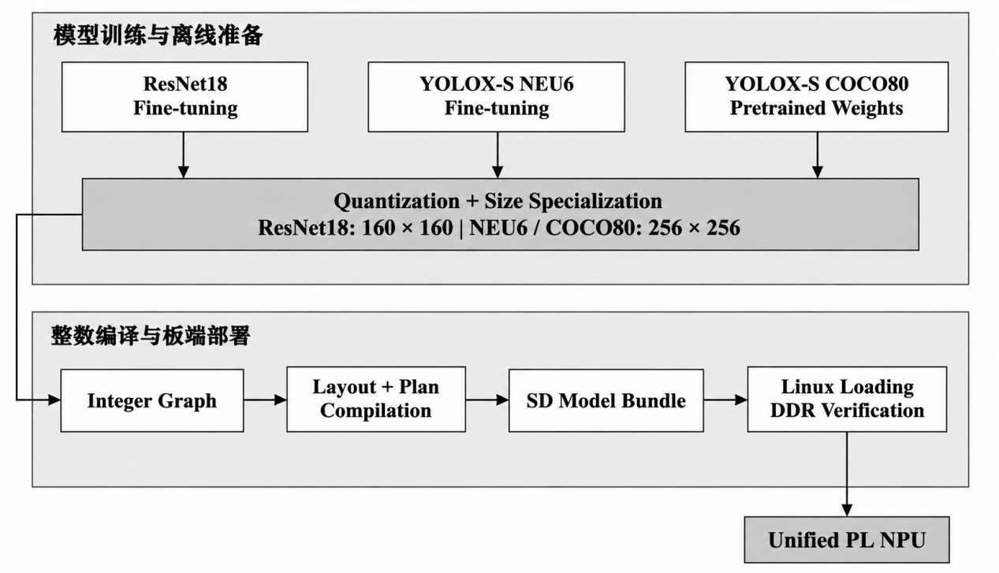
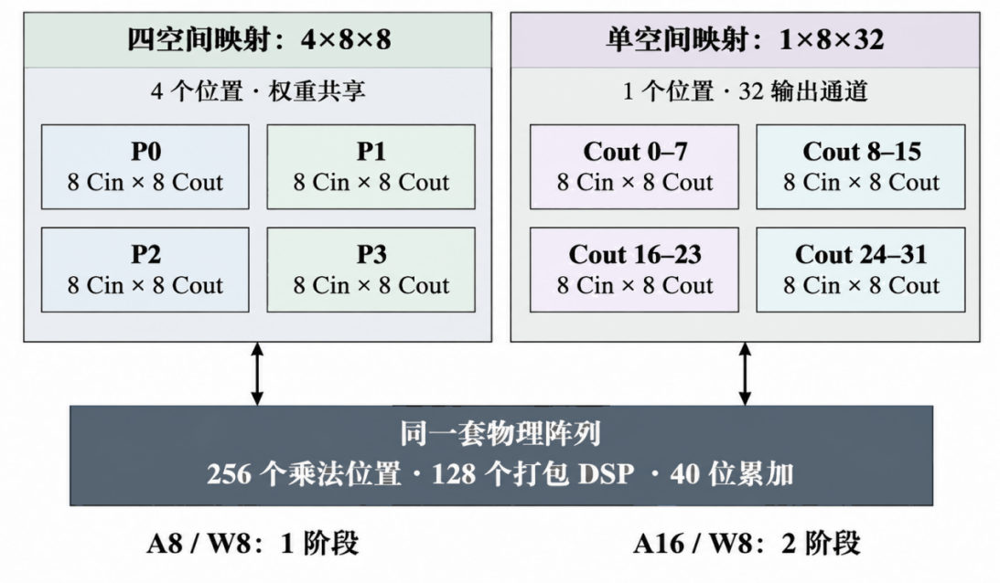
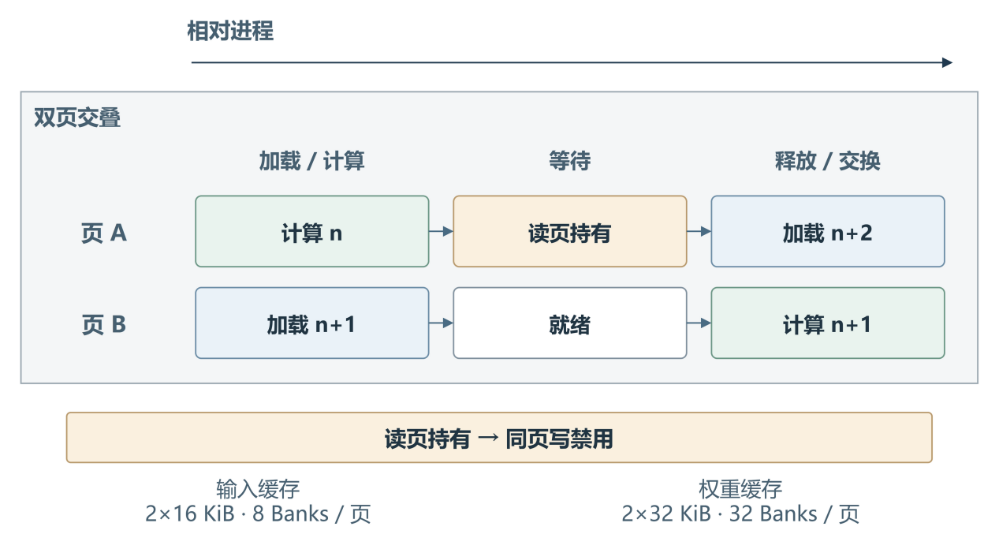
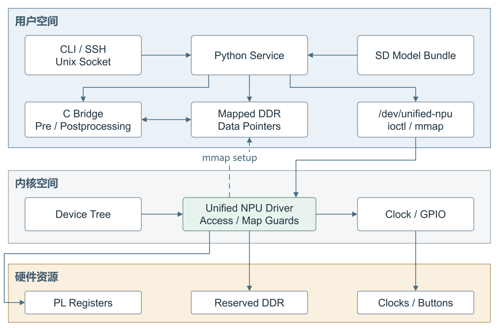

# NPU100 异构边缘AI视觉加速平台设计报告

# 1 项目背景与设计目标

## 1.1 应用需求与研究背景

表面缺陷检测需要同时回答“是什么缺陷”和“缺陷位于哪里”。分类网络与检测网络的输出语义不同，但都包含大量卷积、降采样和非线性计算。若针对每个模型独立搭建硬件，容易重复占用乘加、缓存及访存资源；若完全依赖软件，则需要在处理时延与系统交互之间权衡。

本项目选择 Zynq-7020 的处理系统（Processing System，PS）与可编程逻辑（Programmable Logic，PL）协同工作：PS 管理模型及算法语义，PL 执行规则的数据并行运算和连续视频处理。目标是在同一硬件配置上部署分类、六类缺陷检测与八十类通用检测，并保持摄像头预览、现场按键和独立启动能力。

## 1.2 相关技术与方案定位

ResNet 通过残差连接组织深层特征提取，为分类任务提供了清晰的卷积与逐元素运算组合[1]。YOLOX 采用解耦检测头和无锚框设计，包含特征融合、多尺度输出及检测后处理[2]。本系统据此覆盖残差路径与检测路径，重点验证统一执行后端对不同网络拓扑、张量尺寸和类别规模的适配。

本项目采用自定义 RTL 神经网络处理器（Neural Processing Unit，NPU）。网络差异通过离线执行计划、张量描述和定点参数表达，板端无需为每层重新配置处理器程序。设计重点是计算复用、数据布局、数值一致性以及推理结果与原始图像的正确关联。

## 1.3 功能目标与主要贡献

- **多模型共享计算：**同一套物理 PE、定点算子和 DMA 后端支持三份模型，模型切换通过描述信息和执行计划完成。

- **完整视觉链路：**集成 OV5640、DDR 帧缓存与 HDMI 输出，分类显示置信度，检测显示结果和运行信息，四键完成现场控制。

- **可追溯部署：**从 SD 模型清单到 DDR 回读校验，再到任务提交与结果发布，显式记录模型身份和资源使用权。

- **协作方法沉淀：**保留可核对的真实提示词和纠错记录，将工程完整性与 Linux 分层验收总结为可安装技能。

项目成果包括可重建硬件工程、PS/Linux 源码、主机模型工具、冻结部署产物、技术文档、验证记录与可复用协作技能。

# 2 系统原理与软硬件分工

## 2.1 总体结构与功能路径

平台器件为 xc7z020clg400-2，外部 DDR 为 1 GiB，NPU 相关 PS 输出时钟标称 100 MHz。图 2-1 展示两条协同路径：视频路径持续采集、写帧、读帧并输出 HDMI；推理路径取得完整帧引用，完成预处理、网络执行、后处理与结果发布。两条路径共享 DDR，但通过资源引用和事务完成条件约束读写。



系统启动时先加载模型和进入摄像头预览，默认不自动开始推理。用户选择模型后按启停键运行；停止或切换时，软件阻止新任务进入，取消并排空已接受任务，释放旧帧与工作区，再更新模型状态。

## 2.2 PS 与 PL 划分依据

表 2-1 软硬件职责与划分依据

| 任务 | 实现位置 | 划分依据 |
| --- | --- | --- |
| 模型校验、策略与控制 | PS / Linux | 文件访问、状态管理与错误处理由软件完成 |
| 缩放、输入组织、NMS | PS / C 桥 | 保留算法与阈值的可维护性，复用数值实现 |
| 卷积及定点图执行 | PL / NPU | 规则乘加并行化，减少逐层软件调度 |
| 采集、扫描、OSD / TMDS | PL / 视频链路 | 连续像素处理与独立时钟域 |
| DDR / MMIO / 时钟所有权 | Linux 驱动 | 约束映射范围和资源生命周期 |

这种划分使软件可以在 PL 固定后继续调整模型阈值、服务策略和结果解释。限制也相应明确：新增当前算子集合无法表达的网络，或扩展固定的物理显示接口，需要重新评估硬件与 ABI。系统性能由 PS 处理、网络执行和访存共同决定，不能用 PE 理论峰值代替整机实测。

## 2.3 接口与共享存储约定

控制通路采用 AXI-Lite；PL 的大块图像、模型和张量数据通过 AXI 高性能端口访问 PS DDR。设备树将 [0x10000000, 0x20000000) 预留为 256 MiB no-map 区域，避免 Linux 通用内存分配与 PL 数据区重叠。驱动的 mmap 与 ioctl 接口统一承接用户态资源请求。

表 2-2 关键地址合同

| 用途 | 基地址或范围 | 说明 |
| --- | --- | --- |
| 前端控制 / 图执行控制 | 0x43c10000 / 0x43c18000 | 各 32 KiB 寄存器窗口 |
| 原始视频帧槽 | 0x12000000 起 | 8 个 4 MiB 槽 |
| ResNet18 / NEU6 模型 | 0x14000000 / 0x18000000 | 模型常量独立驻留 |
| 共享工作区 / COCO80 模型 | 0x1a000000 / 0x1b000000 | 工作区与模型区按清单约束 |

地址、大小、数据格式和执行计划共同构成部署合同。复制 XSA 或模型文件本身不足以建立一致性，必须核对启动文件、实时设备树、驱动 ABI、PL 特征以及模型 SHA256。

# 3 模型训练与统一部署

## 3.1 模型来源与输入规格

模型开发在 NVIDIA GPU 平台上使用 PyTorch 与 CUDA 完成。ResNet18 和 YOLOX-S NEU6 采用迁移学习；YOLOX-S COCO80 导入保留八十类检测头的预训练权重。训练、量化与板端推理分别保存配置和产物，权重重排与模型打包不被当作重新量化。

表 3-1 三模型部署合同

| 模型 | 任务 | 板端输入 | 模型 ID |
| --- | --- | --- | --- |
| ResNet18 | NEU 六分类 | 160×160 | 1 |
| YOLOX-S NEU6 | 六类缺陷定位 | 256×256 | 3 |
| YOLOX-S COCO80 | 八十类通用检测 | 256×256 | 4 |

原始图像为 RGB565 视频帧。分类路径执行重采样、归一化和 INT8 张量组织；检测路径保持宽高比缩放并填充至 256×256，按照最终模型约定形成输入。检测框在后处理时使用对应的缩放与填充参数映射回原画面，不能直接将网络坐标当成显示坐标。

## 3.2 量化与整数执行计划



训练后量化（Post-Training Quantization，PTQ）以冻结权重和校准样本为输入，确定权重、激活与重定点参数。系统支持 W8A8 和 W8A16；对敏感层保留较宽激活，以兼顾数值误差与资源占用。量化参考、QDQ ONNX、编译图与最终 model.bin 属于不同阶段，均需关联对应输入尺寸和数值约定。

① 固定选定 checkpoint、数据划分与校准样本；模型尺寸变更后重新检查输入和统计信息。

② 生成并核对量化参考与 ONNX 表达，记录各自精度及差异，固定布局、舍入、饱和和缩放语义。

③ 编译为整数图，生成算子执行计划、张量描述及访存地址；通过权重重排满足硬件读取顺序。

④ 生成统一 SD 模型包，校验模型文件与清单，再在板端写入预留 DDR 并回读验证。

执行计划将网络拓扑转换为硬件可解释的算子序列，模型包同时提供权重常量和张量元数据。Linux 在加载时检查边界与身份，而非仅依据文件名选择模型。

## 3.3 已有精度记录与适用范围

表 3-2 已归档软件精度结果

| 模型与评估形态 | 输入 / 样本数 | 指标结果 |
| --- | --- | --- |
| ResNet18 原始模型 | 224×224 / 270 | 分类准确率 100% |
| NEU6 FP32 / 量化参考 | 640×640 / 360 | mAP50 79.52% / 79.48% |
| NEU6 QDQ ONNX | 640×640 / 360 | mAP50 79.46%，mAP50:95 44.81% |
| COCO80 FP32 / QDQ ONNX | 256×256 / 5000 | mAP50 40.40% / 40.10% |
| COCO80 QDQ ONNX | 256×256 / 5000 | mAP50:95 26.30% |

这些记录用于评价对应的软件参考与导出链。ResNet18 的 224 输入、NEU6 的 640 输入均不同于最终板端尺寸，不能替代 160/256 输入的整数据集板端精度；最终系统的逐样本 Golden 对照仍应另行归档。详细数值、评估形式和文件身份见 data/metrics 与模型流程文档。

# 4 共享 NPU 与视频链路设计

## 4.1 执行计划驱动的共享后端

图控制模块负责接收任务与模型描述，计划后端完成预解码和执行推进，算子分发模块协调卷积、逐元素、池化、全局平均池化、量化和张量转换等资源。共享乘加阵列不为每个模型复制，DDR 中的模型常量相互独立，中间张量和工作区按当前任务复用。

关键源码对应关系为：npu_graph_plan_backend.sv 管理计划执行，npu_plan_dispatch.sv 分发算子，npu_shared_pe.sv 实现并行乘加，输入与权重加载器负责分块装载，流式卷积引擎协调数据供给与结果生成。61 份 RTL 的逐文件中文作用与启用边界见 docs/hardware_modules.md。

## 4.2 两种映射复用同一物理阵列



四空间映射按 4 个空间位置、8 个输入通道和 8 个输出通道组织计算，利用相邻位置的权重复用；单空间映射按 1 个位置、8 个输入通道和 32 个输出通道组织，适应不同形状或边界条件。4×8×8 与 1×8×32 都对应 256 个乘法位置，是同一物理计算资源的两种映射方式。

PE 使用 128 个 DSP 承载打包乘法，整机 DSP 总量为 148。W8A8 模式下，8 位权重与 8 位激活参与打包乘法；A16 激活经字节分解与符号处理完成分阶段累加。打包、校正和累加位宽必须与整数参考一致，不能以资源打包为由省略边界数值验证。

## 4.3 缓存与异步帧的所有权



输入与权重采用分块缓存，加载下一块与当前计算交叠。页切换必须满足当前读取完成，处于读持有状态的页面禁止写入；该条件比简单的乒乓选择信号更重要。算子融合使部分后处理随结果写回完成，减少中间张量在 DDR 的往返。

视频帧同样具有独立所有权：采集完成不等于帧槽可复用，PS 预处理与显示端仍可能持有该帧。只有相关引用归零且 AXI 事务排空后，槽位才能重新用于采集。推理结果携带任务与模型代次，停止或切换后拒绝过期结果发布，避免旧结果叠加到新模型画面。

HDMI 的视频刷新与推理结果更新独立。COCO80 完整类别由软件结果接口保留；固定 PL 标签位宽会限制 HDMI 标签表达，不能把屏幕标签覆盖范围等同于八十类检测头的计算范围。该限制应在演示说明中明确。

# 5 Linux 集成与优化取舍

## 5.1 驱动与用户态分层



板端内核为 6.12.40-xilinx-g31626ef92ff1，ARMv7，采用 SysV init。驱动管理设备树资源、时钟、寄存器和 DDR 映射，用户态通过 /dev/unified-npu 的 ioctl 与 mmap 工作。Python 管理单实例状态和任务生命周期，C 桥复用预处理、数值换算与检测后处理实现。

服务从 SD 读取模型，完成文件与 DDR 回读校验后进入摄像头预览。KEY0、KEY1、KEY2 分别选择 ResNet18、NEU6 与 COCO80，KEY3 控制推理启停。默认模型为 NEU6，上电预览开启、推理关闭。该路线使用自定义 Linux 驱动与 RTL 视频链路，不依赖 PYNQ 框架。

## 5.2 典型问题与修正原则

- **驱动时钟边界：**实际时钟可呈现 99,999,999 Hz，严格等于 100,000,000 的检查曾导致 probe 返回 -34。修正将 ±1 Hz 作为整数舍入容差，同时保留范围检查。该记录证明驱动绑定问题得到处理，不能据此推出模型已运行。

- **显示与结果坐标：**检测框必须贯通模型输出解码、缩放填充逆变换、坐标宽度和屏幕裁剪。分类分数须使用对应量化输出及置信度转换。显示故障不能只凭截图归因为模型精度，需分别核对数值结果和叠加接口。

- **计时来源：**固定 PL 中部分性能计数器关闭，软件必须遵循实际可用计时来源。单张处理时间、纯图执行周期、视频帧率与新检测结果更新率分别表述。

## 5.3 优化依据与代价

表 5-1 关键优化与取舍

| 措施 | 期望作用 | 边界或代价 |
| --- | --- | --- |
| 共享后端与计划执行 | 降低多模型硬件重复 | 受当前算子与计划格式约束 |
| DSP 打包与混合精度 | 提高乘法资源利用 | A16 分阶段；符号校正须一致 |
| 分块 / 双页缓存 | 复用片上数据并交叠访存 | 需要严格页持有和排空条件 |
| 融合与关闭诊断硬件 | 减少往返和控制开销 | 观测能力减少，软件补充计时 |
| DDR 常驻三模型 | 切换时复用硬件资源 | 占用固定内存，启动需加载校验 |

本版具备最终资源与布线时序报告，但尚未归档同一完整工程、同一工具和同一统计阶段的优化前后成对报告。因此，表 5-1 说明设计取舍，不把旧工程资源值或综合黑盒结果当作本版资源节省量。

# 6 验证结果与证据分析

## 6.1 最终实现资源与时序

表 6-1 最终布线资源

| 资源 | 使用 / 总量 | 占用率 |
| --- | --- | --- |
| LUT | 46,278 / 53,200 | 86.99% |
| 寄存器 FF | 45,385 / 106,400 | 42.66% |
| BRAM Tile | 91 / 140 | 65.00% |
| DSP | 148 / 220 | 67.27% |
| Slice | 13,299 / 13,300 | 99.99% |

Vivado 2025.2 最终 routed 报告显示 WNS +0.047 ns、TNS 0、WHS +0.033 ns、THS 0；路由状态为 89,082 条可路由网络全部完成，路由错误数为 0。在现有约束下内部路径时序满足要求。报告仍列出 5 个 no_input_delay 输入和 8 个 no_output_delay 输出，故该结论不扩展为全部外部 IO 时序已完整建模。

LUT 使用率与 Slice 使用率体现不同的物理约束，不能仅根据剩余 LUT 推断还有充足布局空间。最终 Slice 接近容量上限，是后续扩展功能时需要优先考虑的限制。原始报告保存在 build/reports/implementation。

## 6.2 同平台性能比较

表 6-2 单张整网推理时间及加速比

| 模型 | 标量 C / s | NEON双核 / s | 本系统 / s | 相对标量 / NEON |
| --- | --- | --- | --- | --- |
| ResNet18 | 12 | 1.3 | 0.5 | 24.0× / 2.60× |
| YOLOX-S NEU6 | 50 | 4.6 | 1.4 | 35.7× / 3.29× |
| YOLOX-S COCO80 | 55 | 5.1 | 1.6 | 34.4× / 3.19× |
| 各一张合计 | 117 | 11.0 | 3.5 | 33.4× / 3.14× |

表 6-2 为维护者确认的同平台板端近似实测值。标量基线为无 SIMD 的标量 C 整网推理，另一基线为 NEON 优化与双核并行实现。合计加速比采用总时间之比：117÷3.5≈33.4，11.0÷3.5≈3.14，统计任务为每个模型各处理一张，未包含模型切换时间，也不是逐模型加速比的算术平均。

这些时间不等同于摄像头到 HDMI 的端到端时延，视频刷新率也不等同于检测结果更新率。当前归档保存了汇总值，原始重复测量日志、样本数和时延分布仍需补充，后续可据此评估波动与分阶段瓶颈。

## 6.3 分层验证与可追溯性

验证按输入输出边界划分，避免由下层单点成功推导整机正确。现有材料包括定向仿真记录、最终实现报告、模型与精度记录，以及历史板端设备树、驱动、PL ABI、三模型 DDR 回读和自启动安装输出。维护者已确认整机运行；公开材料按原始日志、实现报告与模型记录分别标明证明范围。

表 6-3 验证阶段与证据范围

| 阶段 | 已有材料 | 不能替代的内容 |
| --- | --- | --- |
| 文件与模型合同 | SHA256、包头、清单、布局检查 | 硬件运行与全数据集精度 |
| RTL / 主机回归 | 已归档定向仿真和参考结果 | 最终三模型完整 RTL 回归 |
| 综合与实现 | 最终资源、布线、时序报告 | 重新构建及新的板端验收 |
| Linux / 整机 | 历史启动、PL / DDR 日志 | 逐模型最终 Golden 输出和原始性能日志 |

历史板端输出由维护者在研发对话中提供，本次仅整理和离线核对，没有重新连接开发板。PL ABI 通过和 DDR 文件回读通过均不表示推理已验证；自启动安装后的即时状态为服务未运行，不能作为冷启动成功收据。日志与来源说明位于 evidence/linux/board/user_logs，另有 7 项日志一致性检查通过，与技能自身的 17 项用例分开统计。

当前源码与旧发布包的 107 份核心文件比对中，106 份逐字节一致；wrapper 的唯一差异为日期注释。60 份显式 RTL 与原 XPR 引用集合一致，原 BD 与重建 BD 的组件、参数、连接和地址相符，XSA 内嵌 bit 与归档 bit 字节一致。原构建缺少同期逐源哈希收据，因此这些核对支持来源追溯，不等于证明再次综合会产生逐字节相同的 bitstream。

# 7 大模型协作与技能沉淀

## 7.1 协作流程与真实纠错

大模型参与源码分析、问题定位、脚本整理和文档写作；维护者负责需求、板端观察、工具结果验收与最终确认。公开记录采用真实对话摘录，保留来源会话、消息角色和行号。当前 15 条摘录覆盖工程识别、计时修复、四键改造和交付边界，不代表完整研发历史。

典型提示词为“我之前是让你优化 AI_NPU 的项目，你做错了，你现在重新再做一遍，还是只改代码做静态检查”。这条纠正同时约束了工程身份和验证阶段。后续操作必须先核对当前 XPR、源码引用、输出目录及产物身份，再执行明确授权的工具流程。

① 维护者提出问题及操作范围，附带日志、模型或工程路径。

② 大模型读取可核对证据，列出原因假设并提出代码或脚本修改。

③ 工具输出验证语法、文件身份或指定实现阶段；未运行阶段不写为通过。

④ 维护者进行板端验证并反馈结果，必要时修正前一轮判断；结论与来源一同归档。

该流程保留了失败与纠正，而非只选取成功回答。工程误识别、显示计时与推理计时混用、Linux 驱动绑定与整机运行混淆，均成为后续检查清单的具体来源。

## 7.2 AMD Ross 套件使用心得

历史过程摘要记录了 Ross Vivado 接口的客户端信息、会话发现与最小 Tcl 会话操作。Windows 启动器曾因环境识别问题提前退出，调整启动环境后完成版本、工作目录和工程数量的最小核对。相关原始工具会话现未完整保留，因此这里作为使用过程总结，不作为本版综合、时序或板测的证明。

- **先验证连接再执行设计流程：**工具可用性、会话所属工程和流程完成状态应分开检查；会话存在不代表目标设计已打开。

- **把授权范围写进提示词：**“只改代码做静态检查”应落实为不自动综合、实现或下载，工具能力不替代阶段授权。

- **保留外部工具原始输出：**大模型负责解释和提出修正，工程结论依据报告、日志与可复核产物，不以自然语言总结替代。

对本项目而言，Ross 的价值在于辅助 Vivado 会话与结果分析；实际加速器仍为自定义 RTL。本报告不将该设计表述为使用 AMD DPU、HLS 或 AIE 自动生成，也不编造工具调用次数和效率百分比。

## 7.3 两项技能的形成与验证

表 7-1 可复用技能与适用边界

| 技能 | 来源问题 | 实际功能 |
| --- | --- | --- |
| fpga-release-integrity | 错工程、漏文件、改名后身份难核对 | 逐文件完整性与安全相对路径检查 |
| linux-npu-evidence | 驱动成功被误判为整机成功 | 离线日志分层，识别错误与证据阶段 |

技能包包含 SKILL.md、脚本、示例、使用说明与失效条件。第一项支持发布清单生成及校验，对篡改、缺文件、路径逃逸和空清单拒绝放行；第二项只分析已保存日志，不接触设备、不执行 MMIO 或 DDR 写入。真实驱动日志只能支持驱动层状态，未发现 PL 或推理证据时保留未确认状态。

两项技能完成独立临时安装检查和正反例验证，共 17 项检查通过。该数字反映技能自身的检查用例，不代表整机功能、RTL 仿真或板端测试数量。技能适用于文件完整性核对和 Linux 日志分析，不依赖特定应用框架。验证结果与用法位于 skill/README.md 及对应 JSON 收据。

# 8 复现流程与开放材料

## 8.1 仓库结构与材料入口

仓库按工程职责组织：src 放置硬件、软件、主机工具与第三方源码，sim 保存已归档仿真，build 保存脚本和报告，board 保存启动与部署文件，data 保存模型、划分和指标，skill 保存技能，report 保存报告、协作记录与展示材料。docs、evidence 和 manifests 分别补充操作文档、原始证据与文件身份。

常规文件名采用小写英文、数字、下划线或连字符。README.md、SKILL.md、Makefile、CMakeLists.txt、BOOT.BIN 与模型合同中的固定名称保留兼容性。日期与原始路径可保留在历史收据正文中用于追溯，不作为复现机器上的路径要求。

## 8.2 使用已有产物进行板端部署

① 在仓库根目录运行清单和模型检查，核对冻结模型、bit、XSA 以及部署包身份。

```sh
python tools/release_manifest.py --check
python build/scripts/models/verify_models.py
```

② 准备匹配的 1 GiB DDR、ARMv7、6.12.40-xilinx 内核与 SysV 基础系统；完整基础系统获取方式目前仍需补齐，详见缺失清单。将 board/boot 的三份启动文件成套部署至 SD 启动分区。

③ 将 data/models/runtime/bundle 的完整内容复制到 /home/petalinux/npu100_models，保持内部 models/m1、models/m3 和 coco80 路径。先验证实时设备树，再检查和加载驱动。

```sh
sh board/deploy/boot/verify_after_boot.sh
sh board/linux/driver/check_driver.sh --check-only
sudo sh board/linux/driver/check_driver.sh --load
```

④ 执行用户态安装的 check-only 和 install，随后核对 PL ABI、加载模型并验证 DDR。检查通过后安装 SysV 自启动服务，正常重启核对预览与四键。完整顺序和已有安装的处理条件见 docs/linux.md。

归档板测采用原始部署路径；本仓库的无日期部署前缀为 /opt/npu100 和 /opt/npu100-autostart。路径适配已有主机侧检查，应独立完成新路径版本的板端复核，不能将原路径板测直接改写为新路径板测。

## 8.3 从源码构建与结果验收

① 安装 Vivado 2025.2 和 xc7z020 器件支持，使用 create_project.tcl 在全新输出目录重建 npu100.xpr，检查 BD、约束和引用集合。

```sh
vivado -mode batch -source build/scripts/vivado/create_project.tcl
```

② 需要新 bit/XSA 时，显式运行 build_bitstream.tcl 与 export_hardware.tcl，重新检查最终 routed 报告，不覆盖归档已用产物。

③ 主机模型工具按冻结的训练、量化和编译阶段使用；若修改输入尺寸或量化策略，需重新建立校准、精度及 Golden 对照。匹配内核构建须生成 MODVERSIONS 所需符号信息，再交叉编译驱动和 C 桥。

④ 独立验收时保存软件、PL ABI、DDR 回读、摄像头/HDMI/按键、三模型输出和参考比较的原始记录；性能保留每次计时起止及原始样本。发现阶段缺失时停止向更高层结论外推。

当前已备材料可以支持源码检查、模型与文件合同校验、硬件工程重建和在匹配基础系统上的部署。尚缺完整基础系统生成链、最终全模型原始板测与成对优化记录等，详见附录 A 与 docs/missing_materials.md。开源前还需明确自有代码许可证并完成第三方再分发核对。

# 参考文献

[1] He K, Zhang X, Ren S, Sun J. Deep Residual Learning for Image Recognition. CVPR, 2016. arXiv:1512.03385.

[2] Ge Z, Liu S, Wang F, Li Z, Sun J. YOLOX: Exceeding YOLO Series in 2021. arXiv:2107.08430, 2021.

[3] AMD. Zynq-7000 SoC Technical Reference Manual. UG585.

[4] AMD. Vivado Design Suite User Guide Design Analysis and Closure Techniques. UG906.

[5] AMD. PetaLinux Tools Documentation Reference Guide. UG1144, 2025.2.

[6] 本项目归档材料. build/reports、evidence、data/metrics、report/collaboration 和 manifests. 各文件版本以 SHA256 清单为准.

# 附录 A 待补材料与证据索引

现有材料已经归入对应目录。以下项目按影响区分，避免把未归档内容写成完整复现已经闭合。更新时保留原始记录，不用重写汇总数值代替原始数据。

表 A-1 后续待补项目

| 优先级 | 材料 | 对应目的 |
| --- | --- | --- |
| 发布前 | 基础 SD Linux/rootfs 的公开来源及校验，或完整 PetaLinux/Yocto 工程 | 建立可独立获取的系统起点 |
| 发布前 | 自有代码许可证与第三方/模型再分发说明 | 明确使用与分发授权 |
| 复现关键 | BOOT.BIN 的 BIF、FSBL 与 U-Boot 配置和构建链 | 从源码重建启动文件 |
| 验证补档 | 三模型最终板端日志、输出及同尺寸 Golden 对照 | 核对部署链与计算结果 |
| 验证补档 | 标量、NEON 和本系统原始逐次性能数据 | 支撑计时范围和统计结果 |
| 优化补档 | 同版本完整工程的优化前后资源/时序报告 | 量化优化收益 |
| 模型补档 | 最终尺寸精度、ResNet量化/校准原始链及完整 RTL 回归 | 补全模型与数值验证 |
| 协作补档 | 缺失阶段原始提示词、工具输出或回执 | 扩展可核对的协作范围 |

已有资料入口：原始资源与时序报告见 build/reports；模型来源、划分和精度见 data；驱动及历史 PL / DDR 日志见 evidence/linux/board；61 份 RTL 说明见 docs/hardware_modules.md；文件身份见 manifests；公开协作摘录与 Ross 总结见 report/collaboration；技能用例见 skill。验证覆盖矩阵位于 docs/requirement_matrix.md。
